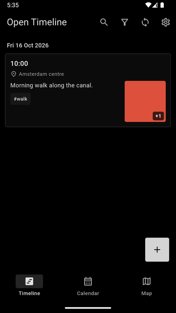
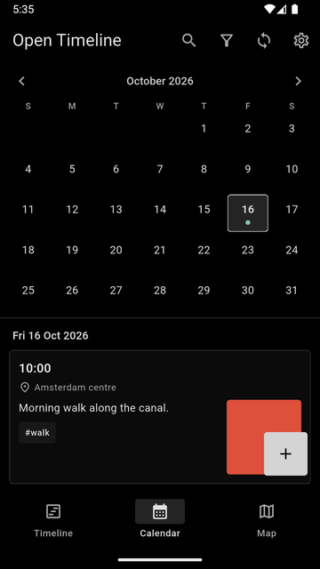
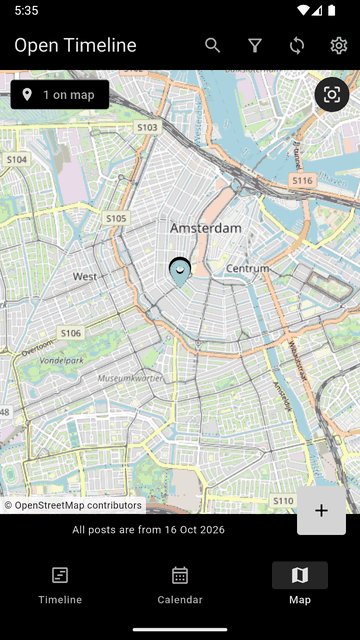
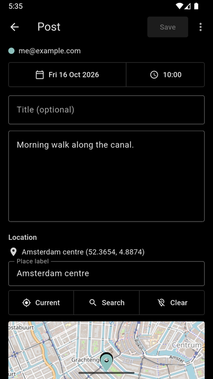

<p align="center"></p>

<h1 align="center">Open Timeline</h1>

<p align="center">A private diary for you and anyone you choose to share it with, one person or many. Posts with a time, a place, text, photos and videos, kept in a Google Drive folder you control as plain files.</p>

<p align="center">
  
  
  
  
</p>

## What it does

- **Posts** with a date and time, an optional location, a title, text, tags, and any number of photos and videos.
- **Timeline, Calendar and Map** views, with "On this day" memories, filters by date, tag and person, and search.
- **One diary, as many people as you like.** Each person uses their own Google account and their own phone, and everyone points the app at the same shared Drive folder. It works just as well with only you. Each person picks their own colour.
- **Sync on a button press.** Nothing runs in the background. If you both edit the same post, nothing is lost: different changes are all kept, and clashing text keeps both versions with a warning.
- **No server and no account with us.** The app talks directly to Google Drive. There is no analytics, advertising or tracking.
- **Your data stays readable.** Posts are ordinary Markdown files and photos sit beside them, so you can read the diary without the app.

Android only. Open Timeline is a sideloaded app, not on the Play Store: download the APK from [Releases](https://github.com/YosYohannes/open-timeline/releases).

## Sharing it with others

1. One person creates a folder called `OpenTimeline` in **My Drive** and shares it with everyone else as **Editor**. If you are the only user, skip the sharing.
2. Everyone installs the APK, opens **Settings**, tap **Sign in with Google**, and paste the same folder link.
3. Write posts. Press the **Sync** icon whenever you want to exchange them.

Files you upload count against your own Google storage, even inside the shared folder. Only a file's owner can delete it, so deleting a post marks it as deleted and each phone removes the photos it uploaded.

## Your data

```
OpenTimeline/                       shared Drive folder
  README.md                         written by the app, explains the format
  2026/
    20261016-143205-k3f9.md         a post: header (time, place, tags...) and text
    20261016-143205-k3f9_x7q2.jpg   its photo
```

```markdown
---
id: "20261016-143205-k3f9"
author: "someone@example.com"
time: "2026-10-16T14:32:05+02:00"
title: "Weekend at the coast"
location: [52.1083, 4.2733]
place: "Scheveningen beach"
tags: ["beach", "family"]
media: ["20261016-143205-k3f9_x7q2.jpg"]
---
We drove out early to beat the traffic...
```

There is no compression or encryption, by design. Any text editor opens a post, and the folder also works as an [Obsidian](https://obsidian.md) vault.

## Privacy and terms

- [Privacy policy](PRIVACY.md)
- [Terms of service](TERMS.md)

## Build it yourself

You need Flutter (stable) and the Android SDK. `tool/env.sh` shows how the development environment is set up.

```bash
source tool/env.sh
flutter test
flutter build apk --release      # signed with the debug key, fine for sideloading
```

Google sign-in needs your own Google Cloud project:

1. Enable the **Google Drive API**.
2. In **Google Auth Platform**, set the audience to **External**, add the scope `https://www.googleapis.com/auth/drive`, and add the Gmail addresses of the people who will use the app as test users (or publish the app).
3. Create an **Android** OAuth client with package name `com.opentimeline.open_timeline` and the SHA-1 of the key that signs your APK (`keytool -list -v -keystore ~/.android/debug.keystore -alias androiddebugkey -storepass android`).
4. Create a **Web application** OAuth client and put its client ID in [`lib/config.dart`](lib/config.dart).

Back up the keystore that signs your APK. If it is lost, sign-in stops working and updates will not install over the existing app.

```
lib/models/   post model and its Markdown file format
lib/store/    the local journal folder on the phone
lib/sync/     Google sign-in, Drive client, merge and the sync engine
lib/ui/       timeline, calendar, map, post editor, settings
test/         unit and widget tests, including a two-phone sync simulation
```
